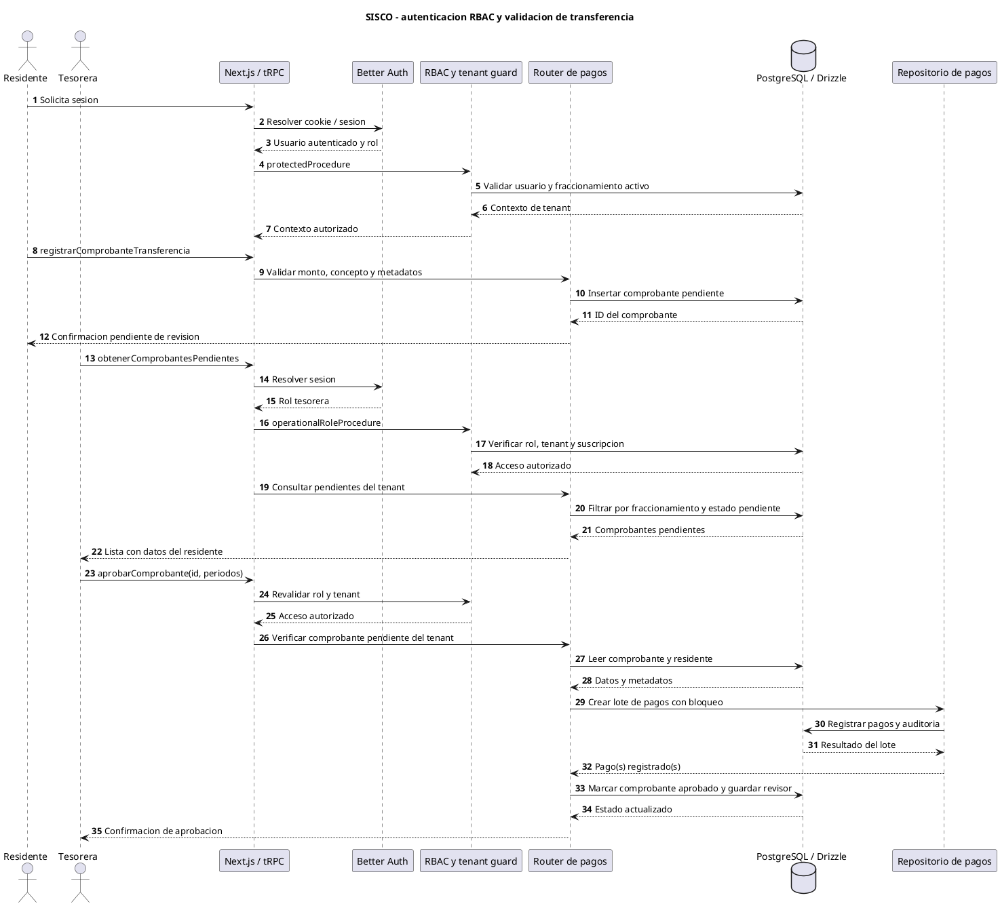
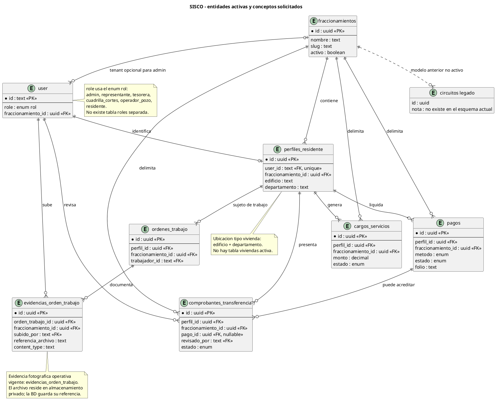

# Anexo técnico: evidencias de SISCO para CONEXIA 2026

**Fecha de revisión del repositorio:** 3 de noviembre de 2026  
**Propósito:** reunir evidencia técnica verificable para su adaptación al artículo científico y al informe de la práctica integradora.

## 1. Alcance, fuentes y límites de verificación

La revisión se realizó sobre el código y la documentación que están presentes en este repositorio. No se encontró adjunto el documento oficial de requisitos de CONEXIA 2026; por ello, las claves `REQ-*` de la matriz son identificadores provisionales derivados de comportamientos observados, no IDs oficiales de la práctica. Deben cruzarse con el pliego oficial antes de presentar la matriz como trazabilidad contractual.

También se separan las cifras históricas especificadas para la práctica de la ejecución local que se pudo repetir el 3 de noviembre. Las tecnologías solicitadas en el brief (Express, Server Actions y Sequelize) no coinciden con la implementación activa observada: el repositorio usa Next.js, tRPC, Route Handlers, PostgreSQL y Drizzle ORM. La diferencia se registra, no se presenta como si fueran equivalentes.

## 2. Arquitectura lógica en tres capas

| Capa | Implementación observada | Responsabilidades y evidencia |
|---|---|---|
| Presentación | React 19, Next.js 16 App Router, Tailwind CSS 4 | Páginas, layouts, componentes y vistas para residentes, tesorería, administración y operación. Véanse [app/](../app/) y [components/](../components/). |
| Negocio | Next.js Route Handlers, tRPC 11, Better Auth, servicios de aplicación y dominio en TypeScript | Autenticación, autorización RBAC/tenant, validación de entradas, reglas de cobro, transferencias, operaciones y reportes. Véanse [server/trpc.ts](../server/trpc.ts), [server/routers/](../server/routers/) y [src/](../src/). |
| Persistencia | PostgreSQL (Neon), Drizzle ORM; Redis de Upstash para límites; Vercel Blob para archivos privados | Datos relacionales, migraciones, protección de tráfico y almacenamiento de evidencia. Véanse [db/schema.ts](../db/schema.ts), [db/migrations/](../db/migrations/) y [app/api/upload/route.ts](../app/api/upload/route.ts). |

La figura de capas y el mapa de componentes se mantienen en el anexo complementario [architecture-diagram.md](../.github/modernize/assessment/engines/facts/architecture-diagram.md). El diagrama describe la arquitectura implementada; no afirma que exista un backend Express independiente.

### Diferencias con el stack enunciado en la solicitud

| Tecnología / concepto solicitado | Evidencia actual | Conclusión para el artículo |
|---|---|---|
| Node.js / Express | Next.js ejecuta las rutas del servidor; `express` no figura en `package.json`. | Describir como backend integrado en Next.js, no como servicio Express. |
| tRPC / Server Actions | tRPC sí está en dependencias y en `server/`; no se identificó uso de Server Actions en el código revisado. | Documentar tRPC y Route Handlers; no atribuir Server Actions sin otra evidencia. |
| PostgreSQL / Sequelize | PostgreSQL y Drizzle aparecen en esquema, consultas y migraciones. `sequelize` no figura como dependencia activa. | Drizzle es el ORM vigente. |
| `PhotoEvidence` | [models/photo-evidence.js](../models/photo-evidence.js) contiene un modelo Sequelize legado; la tabla operativa vigente es `evidencias_orden_trabajo` en [db/schema.ts](../db/schema.ts). | No mezclar el modelo legado con el esquema activo ni usarlo como evidencia de persistencia actual. |
| Circuitos / Viviendas | El esquema actual usa `fraccionamientos`; el perfil residente guarda `edificio` y `departamento`. No hay tablas `circuitos` ni `viviendas` declaradas en el esquema Drizzle vigente. | Tratar “circuito” y “vivienda” como conceptos del modelo anterior o etiquetas funcionales, no como tablas activas. |

### 2.1 Fragmentos de implementación

#### Middleware RBAC y límite de tenant

Extracto abreviado de [server/trpc.ts](../server/trpc.ts):

```ts
export function roleProcedure(...roles: UserRole[]) {
  return protectedProcedure.use(({ ctx, next }) => {
    if (!roles.includes(ctx.user.role)) {
      throw new TRPCError({ code: 'FORBIDDEN', message: 'No tienes permisos' });
    }
    return next({ ctx });
  });
}

export function assertTenantAccess(
  ctx: { user: AuthUser },
  tenantId: string | null | undefined,
): void {
  if (!tenantId) throw new TRPCError({ code: 'BAD_REQUEST' });
  if (ctx.user.role === 'admin') return;
  if (!ctx.user.fraccionamientoId || ctx.user.fraccionamientoId !== tenantId) {
    throw new TRPCError({ code: 'FORBIDDEN' });
  }
}
```

`protectedProcedure` valida sesión, rol configurado y acceso al fraccionamiento activo antes de permitir que continúe el procedimiento. Las mutaciones operativas usan `operationalRoleProcedure`, que además verifica la suscripción para roles no administrativos. La validación no es sólo de interfaz: se ejecuta en el servidor.

#### Esquema vigente con Drizzle

Extracto representativo de [db/schema.ts](../db/schema.ts), no Sequelize:

```ts
export const comprobantesTransferencia = pgTable('comprobantes_transferencia', {
  id: uuid('id').defaultRandom().primaryKey(),
  perfilId: uuid('perfil_id').notNull()
    .references(() => perfilesResidente.id, { onDelete: 'cascade' }),
  fraccionamientoId: uuid('fraccionamiento_id').notNull()
    .references(() => fraccionamientos.id, { onDelete: 'restrict' }),
  monto: decimal('monto', { precision: 10, scale: 2 }).notNull(),
  concepto: text('concepto').notNull(),
  comprobanteUrl: text('comprobante_url').notNull(),
  estado: estadoComprobanteTransferenciaEnum('estado')
    .notNull().default('pendiente_validacion'),
  revisadoPor: text('revisado_por').references(() => user.id),
  pagoId: uuid('pago_id').references(() => pagos.id),
});
```

La tabla de evidencia operativa vigente es `evidencias_orden_trabajo`: asocia una orden, un fraccionamiento y el usuario que sube el archivo; persiste una referencia privada, el MIME y el tamaño. Sus restricciones admiten JPEG, PNG y WebP de hasta 5 MiB.

#### Validación y almacenamiento seguro de archivos

Extracto de [app/api/upload/route.ts](../app/api/upload/route.ts):

```ts
const MAX_FILE_SIZE_BYTES = 5 * 1024 * 1024;
const ALLOWED_MIME_TYPES = {
  'application/pdf': '.pdf',
  'image/jpeg': '.jpg',
  'image/png': '.png',
  'image/webp': '.webp',
};

const session = await auth.api.getSession({ headers: await headers() });
if (!session?.user) {
  return Response.json({ error: 'No autorizado' }, { status: 401 });
}

if (file.size > MAX_FILE_SIZE_BYTES) {
  return Response.json({ error: 'Archivo demasiado grande' }, { status: 413 });
}

const mimeType = (file.type || '').toLowerCase().trim();
if (!ALLOWED_MIME_TYPES[mimeType]) {
  return Response.json({ error: 'Tipo de archivo no permitido' }, { status: 400 });
}
if (!validateFileSignature(buffer, mimeType)) {
  return Response.json({ error: 'Firma binaria inválida' }, { status: 400 });
}

await put(safeFilename, buffer, {
  access: 'private',
  contentType: mimeType,
  addRandomSuffix: false,
  allowOverwrite: false,
});
```

El handler real también valida que el archivo no esté vacío, limita formatos y tamaños, crea una referencia UUID bajo el usuario autenticado y entrega una URL del proxy de lectura. El GET vuelve a exigir sesión y restringe las referencias a `uploads/`. El almacenamiento local/base64 es una vía de respaldo del handler, no la opción de producción recomendada.

#### Aclaración sobre el modelo Sequelize legado

El repositorio contiene [models/photo-evidence.js](../models/photo-evidence.js), cuyo extracto inicia `PhotoEvidence.init(...)` y referencia `Activities` y `Workers`. Sin embargo, Sequelize no aparece en las dependencias del `package.json`, el esquema activo está definido en Drizzle y esa clase no coincide con `evidencias_orden_trabajo`. Por tanto, es evidencia de un artefacto legado en el árbol, no del modelo desplegado actual. El ejemplo de implementación vigente que debe citarse es el esquema Drizzle anterior.

## 3. Diagrama de componentes y flujo de evidencia fotográfica / comprobantes

El flujo distingue la carga de archivo del registro financiero: el handler valida y guarda el objeto; el router registra la referencia en el comprobante o en la evidencia operativa. Una URL privada no equivale por sí misma a una aprobación de pago.

<!-- mermaid-checked: no \n, no em-dash/en-dash, no {} in labels, subgraphs are id["label"], arrows are -->|"label"|, all subgraphs closed by end, ids unique -->
~~~mermaid
flowchart LR
    subgraph UserSide["Client"]
        Resident["Resident or worker"]
        UploadUI["Upload form"]
    end
    subgraph ServerSide["SISCO server"]
        AuthCheck["Session check"]
        UploadAPI["POST api upload"]
        FileCheck["Size MIME and signature checks"]
        PrivateRead["Authenticated GET api upload"]
        PaymentRouter["tRPC payments router"]
        OperationRouter["tRPC operations router"]
    end
    subgraph Storage["Persistence and storage"]
        BlobStore[("Private Vercel Blob")]
        DBStore[("PostgreSQL via Drizzle")]
    end

    Resident -->|"selects file"| UploadUI
    UploadUI -->|"multipart request"| UploadAPI
    UploadAPI -->|"requires session"| AuthCheck
    AuthCheck -->|"authorized request"| FileCheck
    FileCheck -->|"validated object"| BlobStore
    BlobStore -->|"stable private reference"| UploadAPI
    UploadAPI -->|"reference and proxy URL"| UploadUI
    UploadUI -->|"register transfer proof"| PaymentRouter
    PaymentRouter -->|"pending receipt reference"| DBStore
    UploadUI -->|"register work photo"| OperationRouter
    OperationRouter -->|"evidence metadata"| DBStore
    Resident -->|"requests private file"| PrivateRead
    PrivateRead -->|"requires session"| AuthCheck
    AuthCheck -->|"authorized retrieval"| BlobStore
    BlobStore -->|"file content"| PrivateRead
    PrivateRead -->|"protected response"| Resident
~~~

## 4. Secuencia: autenticación RBAC y validación de transferencia

El flujo se basa en los procedimientos `obtenerComprobantesPendientes`, `aprobarComprobante` y `rechazarComprobante` de [server/routers/pagos.ts](../server/routers/pagos.ts). La tesorera está limitada al fraccionamiento de su contexto; el comprobante debe seguir en estado pendiente. La aprobación registra el pago mediante el repositorio con bloqueo/lote y después actualiza el comprobante y la auditoría. Este diagrama describe el camino normal; no afirma que cada operación individual se ejecute en una única transacción global.



**Rama de rechazo:** `rechazarComprobante` exige `tesorera` o `admin`, valida el motivo, localiza un comprobante pendiente del tenant, guarda `rechazado`, `fechaRevision`, `revisadoPor` y registra auditoría.

## 5. Esquema entidad-relación del modelo vigente y conceptos históricos

El siguiente ERD refleja nombres del esquema Drizzle vigente. `PerfilResidente` representa la ubicación de una persona en un fraccionamiento mediante edificio/departamento; el esquema no contiene una tabla `Viviendas`. `CircuitosLegacy` se dibuja con línea discontinua únicamente para dejar constancia del modelo anterior, sin sugerir una relación activa. `Roles` es un enum dentro de `user.role`, no una tabla de roles separada. La evidencia fotográfica activa corresponde a `evidencias_orden_trabajo`, no a la clase Sequelize `PhotoEvidence`.



### Lectura de cardinalidades

- Un fraccionamiento agrupa usuarios, perfiles residentes, cargos, pagos y comprobantes mediante claves de tenant.
- Un usuario tiene a lo sumo un perfil residente (`user_id` único en el perfil); cada perfil conserva su edificio y departamento.
- Los cargos por servicios y los pagos apuntan a un perfil y a su fraccionamiento. El pago tradicional de agua usa la tabla `pagos`; el cargo adicional usa `cargos_servicios`.
- Un comprobante de transferencia tiene un residente, un fraccionamiento y un revisor opcional; al aprobarse puede apuntar al pago resultante.
- Las evidencias operativas pertenecen a una orden de trabajo y registran el usuario que las subió. No son las transferencias bancarias.
- El valor del rol reside en `user.role`; no hay entidad `roles` normalizada en el esquema activo.

## 6. Evidencias de evaluación y pruebas automatizadas

### 6.1 Resultados

| Suite | Resultado solicitado / histórico | Ejecución o evidencia revisada el 3-nov-2026 | Interpretación |
|---|---|---|---|
| Unitarias (Vitest) | 612 aprobadas en 64 archivos, cifra indicada para la práctica | `npm test -- --reporter=dot --silent`: **677 aprobadas en 70 archivos**, exit code 0 | La cifra actual es reproducible en el checkout revisado y sustituye a la histórica para describir este estado del código. |
| Integración (Vitest) | Bloqueo por `TEST_DATABASE_URL` | `npm run test:integration -- --reporter=dot`: **2 suites bloqueadas, 0 pruebas ejecutadas**, exit code 1 | Reproducido: `tests/integration/setup.ts` exige una base de pruebas exclusiva y `envDir: false` evita cargar `.env.local`. No debe usarse `DATABASE_URL` de producción. |
| E2E (Playwright) | 14 pruebas: 2 aprobadas y 12 fallidas | La solicitud reporta 14/2/12; el directorio `test-results/` contiene 12 contextos fallidos. Los contextos inspeccionados fallan al esperar `/residente` y permanecen en `/login` tras 10 s. | Evidencia compatible con credenciales/cuenta de prueba no válida o sesión que no se establece. No demuestra por sí sola que las 12 fallas sean desajustes de sincronización del DOM. |

El código E2E define por defecto `E2E_RESIDENTE_EMAIL=residente@test.local` y `E2E_RESIDENTE_PASSWORD=testpassword123`, sin crear fixtures automáticamente en el archivo de prueba. Debe existir una cuenta de prueba sembrada y configurarse esas variables para una ejecución reproducible. El test de skeleton actualmente comprueba que el dashboard termine renderizando; no sincroniza explícitamente una respuesta lenta para probar que el skeleton se vea.

**Diagnóstico E2E basado en artefactos:** los 12 archivos de contexto comparten el fallo de login (`Expected /residente`, `Received http://localhost:3000/login`). Por tanto, la causa inmediata observada es que el flujo de login no alcanza el dashboard. Una vez corregida la cuenta/sesión de prueba, se debe volver a ejecutar para determinar si persisten problemas de temporización en el DOM. El navegador no se volvió a ejecutar en esta revisión.

### 6.2 Reproducción segura

```powershell
# Unitarias
npm test -- --reporter=dot --silent

# Integración: usar una base aislada, no la base de desarrollo/producción
$env:TEST_DATABASE_URL = "<URL_DE_BASE_EXCLUSIVA_DE_PRUEBAS>"
npm run test:integration -- --reporter=dot

# E2E: levantar la aplicación de prueba con credenciales sembradas
$env:E2E_RESIDENTE_EMAIL = "<USUARIO_DE_PRUEBA>"
$env:E2E_RESIDENTE_PASSWORD = "<CLAVE_DE_PRUEBA>"
npm run test:e2e
```

Las URLs y credenciales son marcadores, no secretos ni endpoints reales. El setup de integración compara `TEST_DATABASE_URL` y `DATABASE_URL` y aborta si coinciden. El comando unitario de arriba se ejecutó en este checkout; integración se ejecutó sin la variable para verificar el guard. E2E se documenta con los resultados proporcionados y artefactos preexistentes, sin ejecución nueva.

## 7. Matriz de trazabilidad técnica provisional

Los requisitos siguientes son una matriz de cobertura observable para la arquitectura actual, no sustituyen IDs ni criterios de aceptación oficiales de CONEXIA. “Implementado” se refiere a evidencia en código; “prueba verde” sólo se afirma cuando hay una suite relacionada ejecutada o identificada.

| ID provisional | Descripción | Capa lógica | Componente / archivo | Nivel de prueba | Estado de verificación |
|---|---|---|---|---|---|
| REQ-ARQ-01 | Presentar paneles web por rol | Presentación | [app/](../app/), [components/](../components/) | E2E Playwright | Parcial: 12 fallas reportadas concentran el acceso al dashboard; no se validó toda la UI. |
| REQ-AUTH-01 | Autenticar cuentas y resolver sesión | Negocio / identidad | [lib/auth.ts](../lib/auth.ts), [server/trpc.ts](../server/trpc.ts) | Unitarias: [auth-route-guard](../tests/lib/auth-route-guard.test.ts), [trpc-route-security](../tests/api/trpc-route-security.test.ts); E2E: [residente-dashboard](../tests/e2e/residente-dashboard.spec.ts) | Implementado; unitarias globales verdes. Login E2E reportado con fallas por sesión/credenciales. |
| REQ-RBAC-01 | Restringir procedimientos por rol | Negocio | [server/trpc.ts](../server/trpc.ts) | Unitarias: [trpc-route-security](../tests/api/trpc-route-security.test.ts), [navigation-role-guards](../tests/navigation-role-guards.test.ts) | Implementado; suite unitaria global aprobada. |
| REQ-TEN-01 | Aislar las operaciones por fraccionamiento | Negocio / persistencia | [server/trpc.ts](../server/trpc.ts), [db/schema.ts](../db/schema.ts) | Unitarias de alcance: [reportes-cuadrilla-scope](../tests/server/reportes-cuadrilla-scope.router.test.ts), [security-dtos](../tests/server/security-dtos.router.test.ts) | Implementado; suite global aprobada; se requiere mapear estos controles a cada criterio oficial. |
| REQ-PER-01 | Mantener perfil y ubicación residente | Negocio / persistencia | [db/schema.ts](../db/schema.ts), [src/](../src/) | Unitarias: [vivienda](../tests/domain/vivienda.test.ts), [residente-aggregate](../tests/domain/residente-aggregate.test.ts), [crear-perfil](../tests/application/crear-perfil.handler.test.ts) | Implementado; modelo de vivienda es perfil con edificio/departamento. |
| REQ-CAR-01 | Generar y consultar cargos de servicios | Negocio / persistencia | [db/schema.ts](../db/schema.ts), [server/routers/servicios.ts](../server/routers/servicios.ts) | Unitarias: [calculator](../tests/domain/calculator.test.ts), [service-cargo-payment](../tests/infrastructure/service-cargo-payment.test.ts) | Implementado; suite unitaria global aprobada. |
| REQ-PAG-01 | Registrar pagos y conservar su estado/folio | Negocio / persistencia | [server/routers/pagos.ts](../server/routers/pagos.ts), [db/schema.ts](../db/schema.ts) | Unitarias: [registrar-pago-manual](../tests/application/registrar-pago-manual.handler.test.ts), [drizzle-pago-repository](../tests/infrastructure/drizzle-pago.repository.test.ts) | Implementado; suite unitaria global aprobada. |
| REQ-TRF-01 | Registrar comprobante de transferencia pendiente | Presentación / negocio / datos | [server/routers/pagos.ts](../server/routers/pagos.ts), [db/schema.ts](../db/schema.ts) | No se identificó prueba unitaria o de integración enfocada al procedimiento de registro del comprobante | Implementado; integración general bloqueada por falta de `TEST_DATABASE_URL`; no hay evidencia E2E satisfactoria de este flujo. |
| REQ-TRF-02 | Permitir que tesorería liste/revise comprobantes de su tenant | Negocio | [server/routers/pagos.ts](../server/routers/pagos.ts) | Unitarias: no se identificó un test enfocado a `obtenerComprobantesPendientes` | Implementado; usa `operationalRoleProcedure` y filtra por tenant; cobertura específica pendiente. |
| REQ-TRF-03 | Aprobar/rechazar transferencia y auditar decisión | Negocio / datos | [server/routers/pagos.ts](../server/routers/pagos.ts) | Unitarias / integración: no se identificó un test enfocado a `aprobarComprobante` o `rechazarComprobante` | Implementado; usa pago por lote, estado de comprobante y auditoría; cobertura específica e integración pendientes. |
| REQ-FILE-01 | Aceptar comprobantes/fotos con autenticación y validación | Negocio / infraestructura | [app/api/upload/route.ts](../app/api/upload/route.ts) | Unitarias: [security.spec](../tests/security.spec.ts), [vercel-blob.adapter](../tests/infrastructure/vercel-blob.adapter.test.ts) | Implementado; suite unitaria global aprobada. |
| REQ-FILE-02 | Restringir acceso a archivos y evidencias operativas | Negocio / datos | [app/api/upload/route.ts](../app/api/upload/route.ts), [db/schema.ts](../db/schema.ts) | Unitarias: [security.spec](../tests/security.spec.ts), [operacion-bitacora-security](../tests/server/operacion-bitacora-security.router.test.ts); integración bloqueada | Implementado en ruta autenticada y esquema; verificación de extremo a extremo pendiente. |
| REQ-MP-01 | Crear checkout y procesar eventos de Mercado Pago | Negocio / integración | [lib/mercadopago.ts](../lib/mercadopago.ts), [app/api/](../app/api/) | Unitarias API: [checkout-mercadopago](../tests/api/checkout-mercadopago.test.ts), [webhook-mercadopago](../tests/api/webhook-mercadopago.test.ts), [return-mercadopago](../tests/api/return-mercadopago.test.ts) | Implementado; suites API relacionadas incluidas en la suite global verde. |
| REQ-OPS-01 | Gestionar órdenes y evidencias de trabajo | Negocio / persistencia | [server/routers/operacion.ts](../server/routers/operacion.ts), [db/schema.ts](../db/schema.ts) | Unitarias: [operacion-bitacora-security](../tests/server/operacion-bitacora-security.router.test.ts), [confirmar-corte](../tests/application/confirmar-corte.handler.test.ts), [confirmar-reconexion](../tests/application/confirmar-reconexion.handler.test.ts); integración pendiente | Implementado; evidencia de tabla y router; la integración está bloqueada. |
| REQ-REP-01 | Exportar reportes financieros | Negocio / presentación | [server/routers/reportes.ts](../server/routers/reportes.ts), [server/services/excel-reportes.ts](../server/services/excel-reportes.ts) | Unitarias: [reportes-excel-servicios](../tests/server/reportes-excel-servicios.test.ts) | Implementado; suite global incluye test de reportes y está verde. |
| REQ-OBS-01 | Exponer chequeo de salud y controles de tráfico | Infraestructura | [app/api/health/](../app/api/health/), [proxy.ts](../proxy.ts) | Unitarias: [health](../tests/api/health.test.ts), [proxy](../tests/proxy.test.ts) | Implementado; suite global aprobada. |

## 8. Registro de reproducibilidad y control de versión

| Dato solicitado | Resultado de verificación |
|---|---|
| Commit | `a8f3b21` (SHA corto comunicado en la solicitud) |
| Fecha indicada | 22 de octubre de 2026 |
| Resultado local | `git show a8f3b21` no resuelve el objeto en el historial disponible del checkout. |
| Resultado GitHub | La consulta al repositorio `Darko2707/sistema-agua` tampoco encontró el SHA corto y el listado de commits remoto para el 22-oct-2026 no devolvió resultados. |
| Conclusión | **No verificable con la evidencia disponible.** No se debe citar como commit validado hasta proporcionar el SHA completo o el enlace al commit correcto. |
| Reproducción demostrada en este checkout | Suite unitaria Vitest: 677/677 en 70 archivos, ejecución exitosa el 3-nov-2026. |

Para cerrar la trazabilidad temporal del artículo, conservar junto al SHA completo: `git show --no-patch --format=fuller <SHA>`, la versión de Node/npm, el lockfile, las variables no secretas de ejecución, los comandos y sus salidas completas. No publicar secretos ni URLs de bases de datos.

## 9. Referencias bibliográficas en formato APA 7

### Ingeniería de software, requisitos y metodologías

Beck, K. (2002). *Test-driven development: By example*. Addison-Wesley.

International Organization for Standardization, International Electrotechnical Commission, & Institute of Electrical and Electronics Engineers. (2018). *Systems and software engineering—Life cycle processes—Requirements engineering* (ISO/IEC/IEEE Standard No. 29148:2018). https://www.iso.org/standard/72089.html

Pressman, R. S., & Maxim, B. R. (2019). *Software engineering: A practitioner’s approach* (9th ed.). McGraw-Hill Education.

Schwaber, K., & Sutherland, J. (2020). *The Scrum guide: The definitive guide to Scrum: The rules of the game*. https://scrumguides.org/scrum-guide.html

Sommerville, I. (2016). *Software engineering* (10th ed.). Pearson.

### Documentación técnica de tecnologías citadas

Better Auth. (s. f.). *Better Auth documentation*. Recuperado el 3 de noviembre de 2026, de https://www.better-auth.com/docs

Drizzle Team. (s. f.). *Drizzle ORM documentation*. Recuperado el 3 de noviembre de 2026, de https://orm.drizzle.team/docs/overview

Meta Open Source. (s. f.). *React documentation*. Recuperado el 3 de noviembre de 2026, de https://react.dev/learn

Microsoft. (s. f.). *Playwright documentation*. Recuperado el 3 de noviembre de 2026, de https://playwright.dev/docs/intro

Neon. (s. f.). *Neon documentation*. Recuperado el 3 de noviembre de 2026, de https://neon.tech/docs

Next.js. (s. f.). *Next.js documentation*. Recuperado el 3 de noviembre de 2026, de https://nextjs.org/docs

PostgreSQL Global Development Group. (s. f.). *PostgreSQL documentation*. Recuperado el 3 de noviembre de 2026, de https://www.postgresql.org/docs/

Tailwind Labs. (s. f.). *Tailwind CSS documentation*. Recuperado el 3 de noviembre de 2026, de https://tailwindcss.com/docs

tRPC. (s. f.). *tRPC documentation*. Recuperado el 3 de noviembre de 2026, de https://trpc.io/docs

Vercel. (s. f.). *Blob documentation*. Recuperado el 3 de noviembre de 2026, de https://vercel.com/docs/storage/vercel-blob

Vitest. (s. f.). *Vitest documentation*. Recuperado el 3 de noviembre de 2026, de https://vitest.dev/guide/

**Nota editorial:** antes de entregar el artículo, confirmar la edición/año exigidos por la institución para Pressman y Sommerville y retirar de la lista final cualquier fuente que no se cite en el cuerpo. No se añadió una entrada bibliográfica distinta para la misma norma ISO; la entrada oficial es la de ISO/IEC/IEEE 29148:2018.
